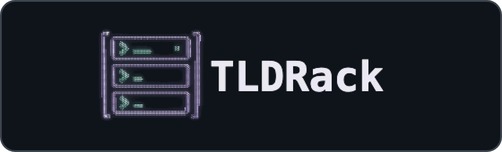
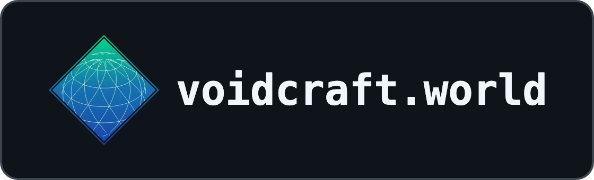

# Vlad Tarsunou

DevOps (AWS-native) and full-stack / AI-native developer in Chicago. **Open to work.**

## Building now

<table>
  <tr>
    <td width="250"></td>
    <td>
      <b><a href="https://github.com/voidcraft-world/tldrack">TLDRack</a></b>: run more agents, read fewer answers. 
      Coding agents side by side in tmux, all on one local page. A local model reads
      finished turns and flags the ones that need you. 
      Python · TypeScript · tmux · local LLM · open source
    </td>
  </tr>
  <tr>
    <td width="250"></td>
    <td>
      <b><a href="https://voidcraft.world">voidcraft.world</a></b>: the anti-folder. 
      A 3D space you and your AI agents share. Put anything down and find it again by
      where you left it; agents join over MCP and propose changes you approve. 
      Vue 3 · Three.js · Lambda · tRPC · DynamoDB · CDK
    </td>
  </tr>
</table>

## Stack

- **Cloud & IaC:** AWS (EKS, Lambda, DynamoDB, Bedrock), CDK, Terraform
- **Containers & CI/CD:** Kubernetes, Docker, Helm, GitLab CI/CD
- **Languages:** TypeScript, Python, SQL, Bash
- **AI:** Claude on Bedrock, MCP agents, RAG, evals
- **Certified:** AWS Generative AI Developer (Professional), AWS Machine Learning (Specialty)

## Contact

[LinkedIn](https://www.linkedin.com/in/uladzislau-tarsunou) · [Email](mailto:utarsunou@gmail.com)
